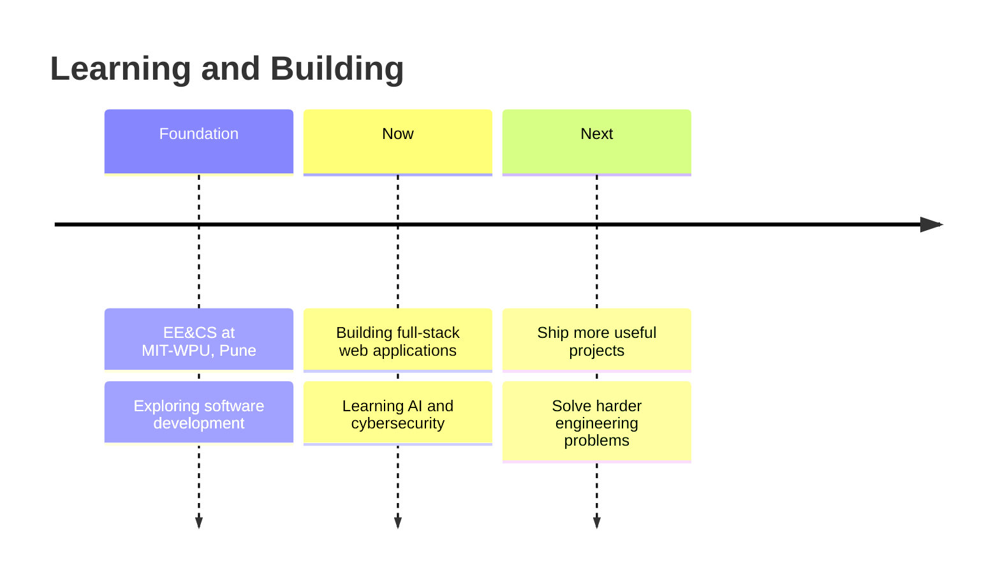

<div align="center">


<a href="https://github.com/harshc17">
  
</a>


</div>

<br/>

```console
harsh@earth:~$ whoami
> Harsh Chandak — EE&CS student at MIT-WPU, Pune

harsh@earth:~$ cat interests.txt
>  Full-stack development · AI/ML · Autonomous Systems · turning ideas into software

harsh@earth:~$ ls projects/
> PaperTradeX/ Rail-Connect / ADAS on Jetson Nano/

harsh@earth:~$ sudo keep-learning
> Access granted. Let's build something useful.
```

> [!TIP]
> I enjoy the path from a rough idea to a working product: design the flow, write the code, test the edge cases, then improve it.

### 💬 Random Dev Quote


---

## ⚡ The Build Log



---

## 🧪 Currently Exploring

| Focus | Status |
|---|---|
| **Full-stack web development** — building complete experiences from UI to database | 🟢 shipping projects |
| **Cybersecurity** — understanding how systems fail and how to make them safer | 🟡 learning in public |
| **AI** — exploring practical ways to build with intelligent systems | 🔁 curiosity loop active |

---

## 🛠️ The Arsenal

<div align="center">


<br/><sub>React · TypeScript · Node.js · Express · MySQL · Python · REST APIs · Git</sub>

</div>

---

## 🚀 Ship Log

| Project | Mission Report |
|---|---|
| 🚂 **[RailConnect](https://github.com/harshc17/RailConnect)** | An IRCTC-inspired train reservation system built with **React, TypeScript, Node.js, Express, and MySQL**. Includes secure authentication, train search, booking flows, PDF tickets, and an admin dashboard. |
| 💸 **[Personal Expense Tracker](https://github.com/harshc17/perosnalexpensetracker)** | A Python project for keeping everyday expenses visible and organized. |
| ⬇️ **[Video Downloader](https://github.com/harshc17/video_downloader)** | A Python utility project for downloading videos. |
| 🎨 **[Portfolio](https://github.com/harshc17/Portfolio)** | A personal portfolio site built for the web. |
| 📝 **[ReactForm](https://github.com/harshc17/ReactForm)** | A JavaScript project focused on creating smooth form interactions. |

---

## 📈 Numbers That Go Up

<div align="center">


<a href="https://leetcode.com/u/harshc17/">
  
</a>


</div>

---

## 🐍 The Snake Ate My Commits

<div align="center">

<picture>
  <source media="(prefers-color-scheme: dark)" srcset="https://raw.githubusercontent.com/harshc17/harshc17/output/github-contribution-grid-snake-dark.svg"/>
  <source media="(prefers-color-scheme: light)" srcset="https://raw.githubusercontent.com/harshc17/harshc17/output/github-contribution-grid-snake.svg"/>
  
</picture>

</div>

---

<details>
<summary>🗝️ &nbsp;<b>CLASSIFIED — open for a little more context</b></summary>
<br/>

- I am an EE&CS student who enjoys learning by building.
- I am especially interested in AI, cybersecurity, and practical software engineering.
- My current project path goes from small Python utilities to full-stack applications with real user flows.
- `while (curious) { learn(); build(); improve(); }`

*This message will not self-destruct. It is Markdown.*

</details>

---

<div align="center">

## 📡 Establish Contact

<a href="https://www.linkedin.com/in/harshc17"></a>&nbsp;
<a href="https://github.com/harshc17"></a>&nbsp;
<a href="https://leetcode.com/u/harshc17/"></a>

<br/>

<sub>⭐ If something here helped, feel free to explore a project or connect.</sub>


</div>
